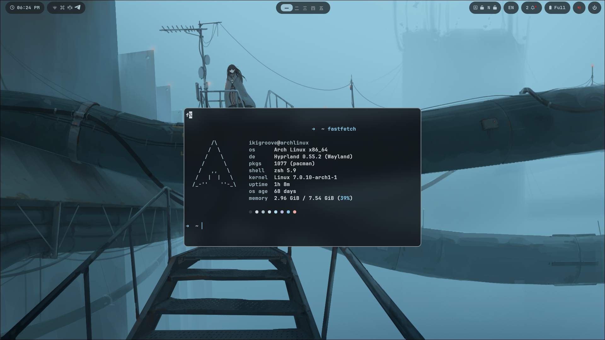

# 🍚 Arch Hyprland Rice

> A modern, aesthetic Arch Linux rice featuring Hyprland with dynamic colors, smooth animations, and a cohesive dark theme.




## ✨ Features

- **Window Manager:** Hyprland — dynamic tiling Wayland compositor with smooth animations
- **Dynamic Colors:** Matugen — automatic color scheme generation from wallpaper
- **Status Bar:** Waybar — highly customizable panel
- **Launcher:** Rofi — application launcher with clipboard history
- **Terminal:** Kitty — GPU-accelerated terminal emulator
- **Notifications:** Swaync — notification center
- **File Manager:** Yazi — terminal-based file manager with previews
- **Wallpaper:** Awww — lightweight wallpaper daemon
- **Screen Lock:** Hyprlock + Hypridle
- **Audio:** PipeWire + WirePlumber + EasyEffects with custom presets

### 🎨 Visual Theme

- **GTK Theme:** adw-gtk3-dark
- **Icons:** Whitesur-dark
- **Cursor:** Bibata Modern Ice
- **Fonts:** JetBrains Mono + Nerd Fonts
- **Color Scheme:** Dynamically generated from wallpaper

## 📦 Requirements

- Arch Linux (btw)
- Internet connection
- Basic terminal knowledge

## 🚀 Installation

### 1. Clone the repository

```bash
git clone https://github.com/yourusername/arch-rice.git
cd arch-rice
```

### 2. Run the installation script

```bash
chmod +x install.sh
./install.sh
```

The script will:

- Install all required packages (both from official repos and AUR)
- Copy all configuration files to ~/.config/
- Copy wallpapers to ~/Pictures/wallpapers/
- Enable PipeWire services
- Apply GTK theme, icons, and cursor

### 3. Start Hyprland
```bash
uwsm start hyprland
```

### Note: 
I use autologin and uwsm to log into Hyprland. I don't remember exactly how I set it up, so the task of figuring out how it works is up to you. The same applies to zsh.

EasyEffects already has several presets for laptops.

## Credits
Base rice inspired by [bennewbs](https://github.com/binnewbs/arch-hyprland)

## License
MIT License — feel free to use, modify, and share!
